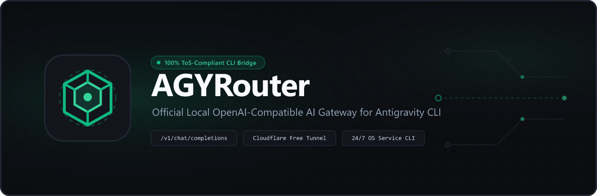

<p align="center">
  
</p>

<h1 align="center">AGYRouter</h1>

<p align="center">
  <strong>AI Gateway &amp; Router Lokal Kompatibel OpenAI yang 100% Resmi &amp; Patuh ToS untuk Google Antigravity CLI (<code>agy</code>)</strong>
</p>

<p align="center">
  <a href="README.md">English</a> · <strong>Bahasa Indonesia</strong> · <a href="https://kikik27.github.io/AGYRouter/">Live Preview</a>
</p>

<p align="center">
  <a href="https://kikik27.github.io/AGYRouter/"></a>
  <a href="LICENSE"></a>
  
  
  
  
  <a href="https://github.com/kikik27/AGYRouter/stargazers"></a>
  <a href="https://github.com/kikik27/AGYRouter/issues"></a>
  <a href="https://github.com/kikik27/AGYRouter/pulls"></a>
</p>

---

## Apa itu AGYRouter?

**AGYRouter** mengubah instalasi lokal **Google Antigravity CLI (`agy`)** menjadi **API Gateway kompatibel OpenAI** (`http://127.0.0.1:8000/v1`) dengan Web Dashboard modern bergaya 9Router, manajemen multi-API Key (`sk-agy-...`), custom model routing, analitik SQLite, CLI `agy-router` berdeteksi device otomatis, installer background service 24/7, serta **Cloudflare Free Tunnel**.

Hubungkan **LangChain, LangGraph, CrewAI, AutoGen, LlamaIndex, Cursor, Cline, Continue, Open WebUI**, atau skrip Python/Node.js langsung ke akun `agy` resmi Anda agar kuota token terpakai optimal tanpa melanggar Terms of Service.

> [!IMPORTANT]
> **100% Resmi & Patuh ToS (Terms of Service)**
>
> AGYRouter **tidak pernah** melakukan web scraping, **tidak** mengambil cookie browser, dan **tidak** memanipulasi endpoint privat. Setiap request dijalankan langsung melalui binary resmi **`agy` CLI** (`agy -p ... --output-format stream-json`) memakai sesi login resmi di mesin Anda.

---

## Fitur Utama

- **Kompatibel Penuh OpenAI (`/v1/chat/completions`, `/v1/models`)**: Mendukung streaming SSE real-time dan non-streaming JSON untuk semua framework agentic.
- **Multi-API Key (`sk-agy-...`) & Auth Persisten 30 Hari**: Buat key per aplikasi/agen, pantau token & request per key, dan sesi dashboard tersimpan 30 hari tanpa bolak-balik login.
- **Custom Model Routing**: Alias populer (`gpt-4o`, `claude-3-5-sonnet`, `gemini-pro`, atau alias custom Anda) otomatis dipetakan ke model resmi AGY.
- **Efisiensi Delta-Turn & Concurrency Gate**: Menyimpan sesi di SQLite dan hanya mengirim pesan turn terbaru saat melanjutkan `--conversation <id>` agar token riwayat tidak terduplikasi.
- **Cloudflare Free Tunnel (`--protocol http2`)**: Auto-install `cloudflared` 1 klik, Quick Tunnel gratis tanpa akun (`https://*.trycloudflare.com/v1`), atau Named Tunnel dengan token.
- **CLI & Service 24/7 Lintas OS**: `agy-router setup` otomatis mendeteksi Windows (Task Scheduler), Linux (`systemctl --user`), dan macOS (`launchd`).
- **Playground Markdown & Live Logs**: Render Markdown lengkap dengan tombol Copy di blok kode, System Prompt, tombol Stop/Regenerate, serta inspeksi log detail.

---

## Mulai Cepat (30 Detik)

```bash
git clone https://github.com/kikik27/AGYRouter.git
cd AGYRouter
```

**Windows:**
```powershell
.\agy-router.bat setup
```

**Linux / macOS:**
```bash
chmod +x agy-router deploy/linux/*.sh
./agy-router setup
```

Atau jalankan perintah CLI spesifik:
```bash
agy-router doctor                 # Cek OS, arsitektur, binary agy & cloudflared
agy-router start --tunnel         # Jalankan server + auto-start Cloudflare Tunnel
agy-router keys create "Cursor"   # Generate API key sk-agy-... dari terminal
agy-router tunnel start           # Jalankan Cloudflare Free Tunnel (HTTP/2)
agy-router service install        # Pasang background service 24/7 otomatis
```

Setelah server aktif:
- **Web Dashboard**: `http://127.0.0.1:8000/` *(Password default awal: `123456`)*
- **OpenAI Base URL**: `http://127.0.0.1:8000/v1`
- **Swagger Docs**: `http://127.0.0.1:8000/docs`

---

## Contoh Integrasi Python (OpenAI SDK / LangChain / CrewAI)

```python
from openai import OpenAI

client = OpenAI(
    base_url="http://127.0.0.1:8000/v1",
    api_key="sk-agy-YOUR_API_KEY",
)

response = client.chat.completions.create(
    model="gemini-3.8-flash-high",
    messages=[
        {"role": "system", "content": "Kamu adalah asisten AI yang membantu."},
        {"role": "user", "content": "Halo!"}
    ],
    stream=True,
    user="agent-session-1"
)

for chunk in response:
    print(chunk.choices[0].delta.content or "", end="", flush=True)
```

---

## Open Source, Kontribusi & Kredit

**AGYRouter** bersifat **Open Source** (Lisensi MIT) oleh **[@kikik27](https://github.com/kikik27)**.

Jika menemukan kendala atau ingin berkontribusi mengembangkan proyek ini, silakan langsung **Open Issue** atau kirim **Pull Request (PR)**:
- **Laporkan Bug / Request Fitur:** [github.com/kikik27/AGYRouter/issues](https://github.com/kikik27/AGYRouter/issues)
- **Kirim Pull Request:** [github.com/kikik27/AGYRouter/pulls](https://github.com/kikik27/AGYRouter/pulls)
- Panduan lengkap ada di [CONTRIBUTING.md](CONTRIBUTING.md) dan kebijakan keamanan di [SECURITY.md](SECURITY.md).
