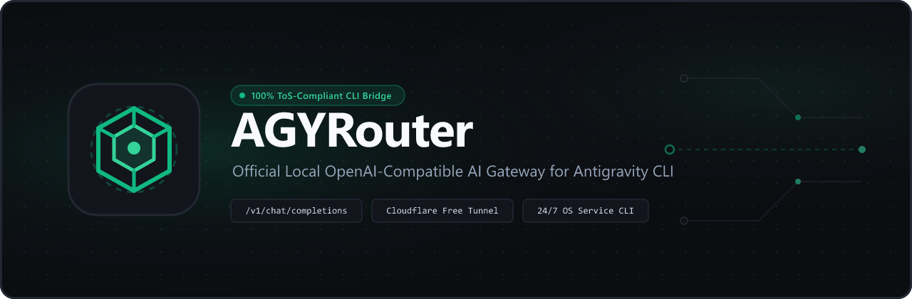
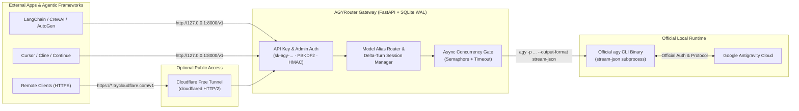

<p align="center">
  
</p>

<h1 align="center">AGYRouter</h1>

<p align="center">
  <strong>Official, ToS-Compliant OpenAI-Compatible Local AI Gateway &amp; Router for Google Antigravity CLI (<code>agy</code>)</strong>
</p>

<p align="center">
  <strong>English</strong> · <a href="README.id.md">Bahasa Indonesia</a> · <a href="https://kikik27.github.io/AGYRouter/">Live Preview</a>
</p>

<p align="center">
  <a href="https://kikik27.github.io/AGYRouter/"></a>
  <a href="LICENSE"></a>
  
  
  
  
  <a href="https://github.com/kikik27/AGYRouter/stargazers"></a>
  <a href="https://github.com/kikik27/AGYRouter/issues"></a>
  <a href="https://github.com/kikik27/AGYRouter/pulls"></a>
</p>

---

## What is AGYRouter?

**AGYRouter** turns your local **Google Antigravity CLI (`agy`)** installation into a production-ready, **OpenAI-compatible HTTP API gateway** (`http://127.0.0.1:8000/v1`) complete with a 9Router-inspired dark-terminal dashboard, multi-API key management (`sk-agy-...`), custom model alias routing, SQLite analytics, a device-aware `agy-router` CLI, 24/7 background service installers, and built-in **Cloudflare Free Tunnels**.

Connect **LangChain, LangGraph, CrewAI, AutoGen, LlamaIndex, Cursor, Cline, Continue, Open WebUI**, or custom scripts directly to your official `agy` subscription/session without wasting tokens or violating Terms of Service.

> [!IMPORTANT]
> **100% Terms-of-Service Compliant Architecture**
>
> AGYRouter **never** scrapes web UIs, **never** extracts private browser cookies, and **never** spoofs undocumented private APIs. Every request is dispatched directly through your locally installed, officially authenticated **`agy` CLI binary** (`agy -p ... --output-format stream-json`).

---

## Key Features

| Capability | Details |
| :--- | :--- |
| **OpenAI-Compatible API** | Drop-in `/v1/chat/completions` (SSE streaming & JSON) + `/v1/models` compatible with the `openai` SDK and all agentic frameworks. |
| **Multi-API Key Auth** | Generate scoped `sk-agy-...` keys per app/agent, toggle active/disabled state, track per-key request & token metrics. |
| **Custom Model Routing** | Built-in + custom alias mapping (e.g. `gpt-4o`, `claude-3-5-sonnet`, `gemini-pro` -> native `agy` models) so frameworks work out of the box. |
| **Delta-Turn Efficiency** | Persists multi-turn sessions in SQLite (`sessions` table) and trims prior assistant history on `--conversation` continuations to avoid duplicating input tokens. |
| **Cloudflare Free Tunnel** | 1-click `cloudflared` auto-install, Quick Tunnels (`*.trycloudflare.com` with `--protocol http2`), Named Tunnels (`--token`), and auto-start toggle. |
| **Device-Aware CLI & 24/7 Service** | `agy-router setup` auto-detects Windows, Linux (`systemd --user`), WSL, or macOS (`launchd`) and configures 24/7 autostart services in one command. |
| **9Router-Style Web UI** | 30-day persistent admin auth, 24h SVG traffic analytics, Integration Center code snippets, Markdown Playground with Stop/Regenerate, and Live Request Logs. |

---

## Architecture



---

## Quick Start (30 Seconds)

### Prerequisites
- **Python 3.10+**
- **Google Antigravity CLI (`agy`)** installed and logged in (`agy models` works in your terminal)

### 1. Clone & Run Interactive Setup
```bash
git clone https://github.com/kikik27/AGYRouter.git
cd AGYRouter
```

**Windows (PowerShell / CMD):**
```powershell
.\agy-router.bat setup
```

**Linux / macOS:**
```bash
chmod +x agy-router deploy/linux/*.sh
./agy-router setup
```

The interactive wizard automatically detects your OS/device, initializes SQLite, lets you change the default admin password (`123456`), reveals/generates your `sk-agy-...` API key, optionally installs **Cloudflare Tunnel**, and optionally registers the **24/7 background service**.

### 2. Manual Start (Without Service)
```powershell
# Windows
.\start.bat
# Or using CLI:
.\agy-router.bat start --tunnel
```

Once running:
- **Web Dashboard**: `http://127.0.0.1:8000/` *(Default password: `123456` — persisted for 30 days)*
- **OpenAI Base URL**: `http://127.0.0.1:8000/v1`
- **Swagger API Docs**: `http://127.0.0.1:8000/docs`

---

## `agy-router` CLI Reference

| Command | Description |
| :--- | :--- |
| `agy-router setup` | Guided setup wizard (device detection, password, API key, tunnel, 24/7 service) |
| `agy-router doctor` | Diagnose OS, architecture, WSL status, `agy` binary, `cloudflared`, DB, and ports |
| `agy-router status` | Show gateway health, Local/LAN URLs, active API keys, and background service state |
| `agy-router start [--tunnel] [--background]` | Start gateway (optionally with Cloudflare Tunnel auto-start or detached daemon) |
| `agy-router stop` | Stop background gateway process |
| `agy-router keys list \| create <name>` | List, create, enable, disable, or delete `sk-agy-...` API keys |
| `agy-router tunnel install \| start` | Auto-download `cloudflared` and start a free HTTPS tunnel (`--protocol http2`) |
| `agy-router service install \| uninstall \| status \| logs` | Install or manage the 24/7 OS background service (auto-detected per OS) |
| `agy-router password` | Update the dashboard admin password |

---

## Agentic Framework & IDE Integration

Point any OpenAI-compatible client to `http://127.0.0.1:8000/v1` (or your LAN / Cloudflare Tunnel URL) with your `sk-agy-...` key:

### Python (`openai` SDK)
```python
from openai import OpenAI

client = OpenAI(
    base_url="http://127.0.0.1:8000/v1",
    api_key="sk-agy-YOUR_API_KEY",
)

stream = client.chat.completions.create(
    model="gemini-3.8-flash-high",  # or aliases like "gpt-4o", "claude-3-5-sonnet"
    messages=[
        {"role": "system", "content": "You are a helpful engineering assistant."},
        {"role": "user", "content": "Summarize how delta-turn sessions save tokens."},
    ],
    stream=True,
    user="research-agent-1",  # Keeps multi-turn context via SQLite + --conversation
)

for chunk in stream:
    print(chunk.choices[0].delta.content or "", end="", flush=True)
```

### LangChain / LangGraph / CrewAI
```python
from langchain_openai import ChatOpenAI

llm = ChatOpenAI(
    base_url="http://127.0.0.1:8000/v1",
    api_key="sk-agy-YOUR_API_KEY",
    model="gemini-3.8-flash-high",
)
print(llm.invoke("Plan a 3-step competitive analysis.").content)
```

### Cursor / Cline / Continue / Open WebUI
- **Provider**: `OpenAI`
- **API Base URL**: `http://127.0.0.1:8000/v1` (or `https://xxxx.trycloudflare.com/v1`)
- **API Key**: `sk-agy-YOUR_API_KEY`
- **Model**: `gemini-3.8-flash-high`, `gemini-4-neon-high`, `claude-sonnet-5-5-high`, etc.

---

## Cloudflare Free Tunnel & 24/7 Service

### Cloudflare Free Tunnel
Expose your local gateway over HTTPS with zero port forwarding from the **Tunnel & Service** tab or CLI:
- **Quick Tunnel (No Cloudflare account required):** Uses `--protocol http2` by default so it works reliably behind local ISPs/firewalls that block UDP QUIC. Generates a live `https://*.trycloudflare.com/v1` endpoint.
- **Named Tunnel (Custom Domain):** Paste your Cloudflare Zero Trust tunnel token for a permanent hostname.

### 24/7 Background Autostart
- **Windows:** `.\agy-router.bat service install` registers a hidden Windows Scheduled Task (`AGY-Router-Gateway`) running silently via `wscript.exe` with auto-restart.
- **Linux (`systemctl`):** `./agy-router service install` (or `./deploy/linux/install-systemd.sh --user`) installs a `systemd --user` service with linger enabled so it stays alive after logout while keeping access to `~/.gemini/antigravity-cli`.
- **macOS:** `./agy-router service install` registers a `LaunchAgent` under `~/Library/LaunchAgents/`.

> [!WARNING]
> Always change the default dashboard password (`123456`) and keep **Require API Key** enabled before exposing AGYRouter via a public tunnel. See [SECURITY.md](SECURITY.md).

---

## API & Configuration Reference

### Endpoints
| Endpoint | Auth | Description |
| :--- | :--- | :--- |
| `POST /v1/chat/completions` | API Key | OpenAI-compatible chat completions (streaming SSE & JSON) |
| `GET /v1/models` | API Key | List available AGY models and custom routing aliases |
| `POST /api/chat` | API Key | Simplified native REST prompt endpoint |
| `GET /health` | Public | Lightweight health & `agy` binary availability check |
| `GET /docs` | Public | Interactive Swagger / OpenAPI documentation |

### Environment Variables (`.env`)
| Variable | Default | Description |
| :--- | :--- | :--- |
| `HOST` | `0.0.0.0` | Bind address (`0.0.0.0` allows LAN/Docker/WSL access) |
| `PORT` | `8000` | HTTP server port |
| `DASHBOARD_PASSWORD` | `123456` | Initial admin password (hashed into SQLite on first boot) |
| `DEFAULT_MODEL` | `gemini-3.8-flash-high` | Fallback model when requested model is omitted |
| `AGY_PATH` | *(auto-detect)* | Optional explicit path to `agy` executable |
| `ALLOW_TOOL_EXECUTION` | `false` | Pass `--dangerously-skip-permissions` to `agy` (keep `false` for chat) |
| `MAX_CONCURRENT_REQUESTS` | `4` | Max concurrent `agy` subprocesses |
| `AGY_TIMEOUT_SECONDS` | `180` | Per-request execution timeout in seconds |

---

## Contributing, Issues & Credits

**AGYRouter** is an **Open Source** project created and maintained by **[@kikik27](https://github.com/kikik27)**.

Found a bug, need a new integration, or want to improve the gateway?
- **Open an Issue:** [github.com/kikik27/AGYRouter/issues](https://github.com/kikik27/AGYRouter/issues)
- **Submit a Pull Request:** [github.com/kikik27/AGYRouter/pulls](https://github.com/kikik27/AGYRouter/pulls)
- Read [CONTRIBUTING.md](CONTRIBUTING.md) and [CHANGELOG.md](CHANGELOG.md).

Released under the [MIT License](LICENSE) — Copyright &copy; 2026 **kikik27**.
